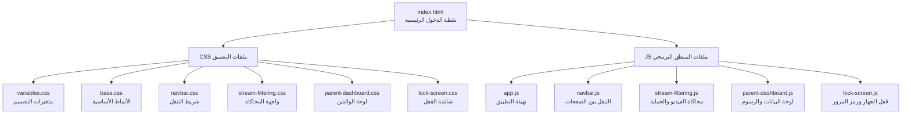
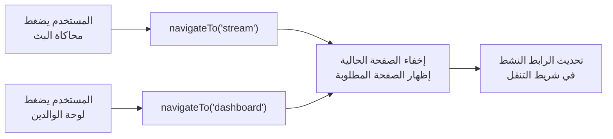
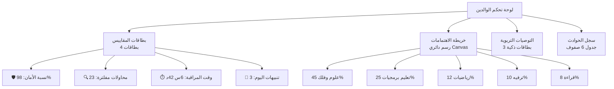
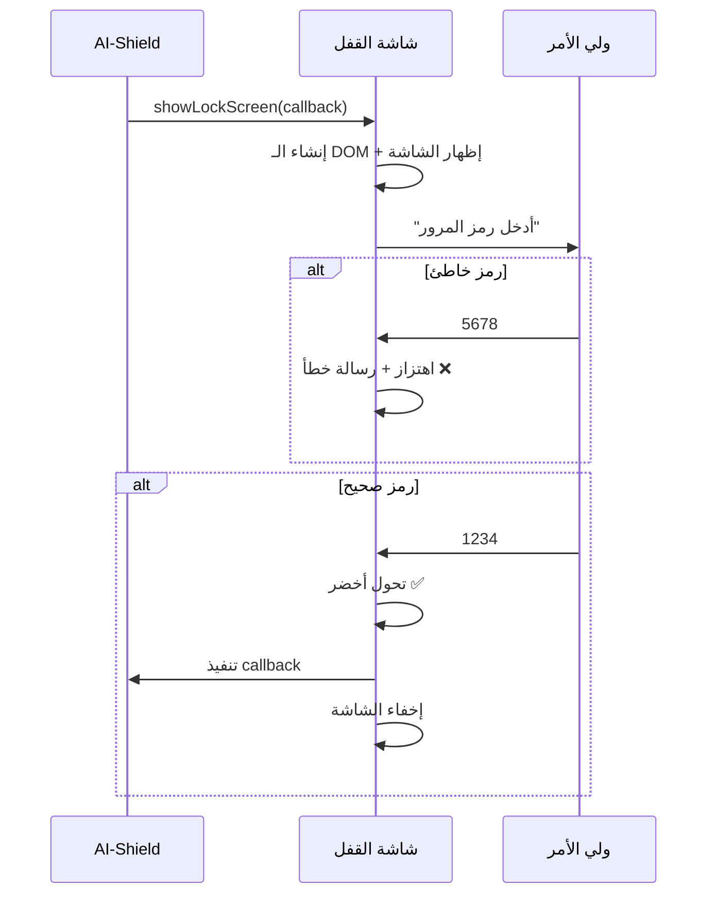

# 🛡️ شرح مشروع حارس الطفولة الذكي | AI-Shield

---

## 1. الفكرة العامة

**حارس الطفولة الذكي** هو نظام حماية ذكي يعمل بالذكاء الاصطناعي لحماية الأطفال واليافعين من المحتوى الرقمي غير المناسب **بشكل فوري ولحظي** أثناء مشاهدتهم للمحتوى.

> [!IMPORTANT]
> هذا التطبيق هو **نموذج تفاعلي (Prototype)** يُحاكي آلية عمل النظام الحقيقي — وليس النظام الفعلي نفسه. الهدف منه هو **عرض الفكرة بشكل مرئي وتفاعلي** للجنة التحكيم في جائزة نورة الملاحي.

---

## 2. هيكلية الملفات ودور كل ملف



---

### 📄 index.html — نقطة الدخول
- يحمّل خط **Tajawal** العربي من Google Fonts
- يربط جميع ملفات CSS و JS بالترتيب الصحيح
- يحتوي على هيكل الصفحة الأساسي: شريط التنقل (`navbar`) + حاوية التطبيق مع صفحتين (`view-stream` و `view-dashboard`)
- الصفحات **لا تحتوي على محتوى ثابت** — المحتوى يُولَّد ديناميكياً بواسطة JavaScript

---

### 🎨 ملفات CSS (التنسيق والتصميم)

| الملف | الدور |
|-------|-------|
| **variables.css** | يعرّف جميع **متغيرات التصميم** (الألوان، الخطوط، المسافات، الظلال، الحدود، تأثيرات الزجاج). أي تغيير هنا ينعكس على كامل التطبيق |
| **base.css** | **إعادة ضبط** المتصفح (Reset)، أنماط الجسم (body) بخلفية متحركة بتدرجات، أنماط الأزرار والشارات والبطاقات الزجاجية، تأثير النبض الضوئي |
| **navbar.css** | تنسيق شريط التنقل العلوي الثابت بتأثير الزجاج (Glassmorphism)، الشعار، روابط التنقل مع مؤشر الصفحة النشطة |
| **stream-filtering.css** | تنسيق مشغل الفيديو، شارة حالة AI، طبقة التنبيه البصري (Overlay)، شريط التشغيل، أزرار التحكم بالسيناريو، وسجل الاستجابة |
| **parent-dashboard.css** | تنسيق بطاقات المقاييس الأربع، حاوية الرسم البياني، بطاقات التوصيات التربوية، جدول سجل الحوادث |
| **lock-screen.css** | تنسيق شاشة القفل الكاملة: خلفية حمراء نابضة، خطوط مسح ضوئي، أيقونة الدرع، حقول إدخال PIN مع تأثيرات الخطأ والنجاح |

---

### ⚙️ ملفات JavaScript (المنطق البرمجي)

#### 🔹 app.js — المنسق الرئيسي
```
المهمة: ينتظر تحميل الصفحة، ثم يُهيّئ كل المكونات بالترتيب
```
- ينادي `Navbar.init()` → يبني شريط التنقل
- ينادي `StreamDemo.init()` → يبني واجهة المحاكاة
- ينادي `Dashboard.init()` → يبني لوحة الوالدين
- يُفعّل الصفحة الأولى (محاكاة البث)

---

#### 🔹 navbar.js — التنقل بين الصفحات



- **`initNavbar()`** — يبني HTML شريط التنقل ديناميكياً (الشعار + زرّي التنقل + مؤشر الحالة)
- **`navigateTo(viewName)`** — يُبدّل بين الصفحتين بتأثير انسيابي
- **`updateNavStatus(status, text)`** — يُحدّث مؤشر الحالة (أخضر = آمن، أحمر = تهديد)

---

#### 🔹 stream-filtering.js — قلب المشروع 💡

هذا أكبر وأهم ملف. يحتوي على:

##### أ) محاكاة الفيديو التفاعلي (Canvas Animation)
```
يرسم مشهداً فضائياً متحركاً يحاكي برنامجاً تعليمياً للأطفال:
  🌟 خلفية فضائية بـ 180 نجمة تومض
  🪐 كوكب زحل في المركز مع حلقاته
  🌍 كواكب تدور في مدارات (الأرض، المريخ، المشتري)
  ✨ جسيمات غبار كوني عائمة
  📺 شريط "قناة المعرفة للأطفال" في الأسفل
  🔴 شارة "مباشر" في الزاوية
  🛡️ علامة "AI-Shield Frame Capture" المائية
  ── خط مسح ضوئي خفيف يتحرك (يوحي بالمراقبة الذكية)
```

##### ب) ثلاثة سيناريوهات تفاعلية:

````carousel
### 🟡 السيناريو الأول: تضبيب واستجابة طرفية
عند الضغط على **"محاكاة لقطة غير مناسبة"**:
1. يُطبَّق تأثير ضبابي كثيف `filter: blur(24px)` على الفيديو
2. يُكتم الصوت (أيقونة 🔇)
3. تظهر طبقة تنبيه بصرية فوق الفيديو
4. تتحول شارة AI-Shield إلى أحمر
5. يتحدث شريط التنقل: "تم رصد تهديد"
6. يُسجَّل الحدث في سجل الاستجابة

```javascript
// المنطق الأساسي
canvasEl.classList.add('blurred');     // تضبيب
overlay.classList.add('visible');      // تنبيه بصري
volumeIcon.textContent = '🔇';        // كتم الصوت
updateAIStatus('danger', '⚠️ ...');   // تغيير الحالة
```
<!-- slide -->
### 🔴 السيناريو الثاني: قفل الجهاز بالكامل
عند الضغط على **"محاكاة محتوى خطير جداً"**:
1. يُطبَّق التضبيب أولاً (السيناريو الأول)
2. ثم تظهر **شاشة قفل حمراء كاملة** تغطي الشاشة بالكامل
3. الشاشة تحتوي على: درع نابض + رسالة تحذير + حقول PIN
4. **لا يمكن الخروج** إلا بإدخال رمز الوالدين: `1234`
5. عند إدخال رمز خاطئ: تهتز الحقول + رسالة خطأ
6. عند إدخال الرمز الصحيح: تتحول الحقول للأخضر → يُفتح القفل

```javascript
// يستدعي مكون lock-screen.js
LockScreen.show(() => {
  // هذا الكود يُنفَّذ بعد الفتح بنجاح
  handleResumeDemo();
});
```
<!-- slide -->
### 🟢 السيناريو الثالث: استئناف المحتوى الآمن
عند الضغط على **"استئناف المحتوى الآمن"**:
1. يُزال التضبيب عن الفيديو
2. يعود الصوت (أيقونة 🔊)
3. تختفي طبقة التنبيه البصري
4. تعود شارة AI-Shield إلى الأخضر
5. يعود شريط التنقل: "النظام نشط"

```javascript
canvasEl.classList.remove('blurred');
overlay.classList.remove('visible');
volumeIcon.textContent = '🔊';
updateAIStatus('safe', 'الحماية نشطة');
```
````

---

#### 🔹 parent-dashboard.js — لوحة تحكم الوالدين



- **المقاييس**: بيانات محاكاة توضح مستوى أمان الجهاز
- **الرسم البياني**: مرسوم بـ Canvas API يعرض تصنيف اهتمامات الطفل
- **التوصيات**: بطاقات ذكية تقترح مواضيع حوار ودّي مع الطفل بناءً على اهتماماته
- **سجل الحوادث**: يعرض وقت الاستجابة (بالمللي ثانية) ونوع الإجراء دون تفاصيل تنتهك الخصوصية

---

#### 🔹 lock-screen.js — شاشة القفل



---

## 3. كيف تتواصل المكونات مع بعضها؟

كل ملف JS يُصدّر كائناً على `window` يحتوي على دوال عامة:

```
window.Navbar     → { init, navigateTo, updateStatus }
window.StreamDemo → { init, onActivate, onDeactivate }
window.Dashboard  → { init, onActivate }
window.LockScreen → { show, hide }
```

هذا يسمح لأي مكون بمناداة مكون آخر. مثلاً:
- **stream-filtering.js** ينادي `LockScreen.show()` عند محاكاة القفل
- **stream-filtering.js** ينادي `Navbar.updateStatus()` لتغيير لون المؤشر
- **navbar.js** ينادي `Dashboard.onActivate()` عند التبديل للوحة التحكم

---

## 4. التقنيات والمفاهيم المُحاكاة

| التقنية | الوصف | كيف تُحاكى في التطبيق |
|---------|-------|----------------------|
| **GSF** (Generative Stream Filtering) | ترشيح البث اللحظي | التضبيب الفوري للفيديو عند الضغط |
| **Computer Vision** | رؤية حاسوبية لتحليل الإطارات | خط المسح الضوئي + علامة Frame Capture |
| **Edge Response** | استجابة طرفية فورية | وقت استجابة محاكى (23ms) |
| **Device Lock** | قفل الجهاز الكامل | شاشة القفل الحمراء مع PIN |
| **AI Pedagogical Prompts** | توصيات تربوية ذكية | بطاقات التوصيات في لوحة الوالدين |
| **Privacy-preserving Logs** | سجلات تحترم الخصوصية | جدول الحوادث بدون تفاصيل المحتوى |

---

## 5. ملاحظات تقنية مهمة

> [!TIP]
> - رمز PIN لإلغاء القفل: **`1234`**
> - التطبيق يعمل بالكامل **في المتصفح** بدون خادم خلفي (Backend)
> - جميع البيانات **محاكاة** (Mock Data) لأغراض العرض
> - التصميم **متجاوب** (Responsive) ويعمل على الجوال والحاسوب
